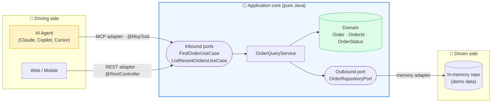
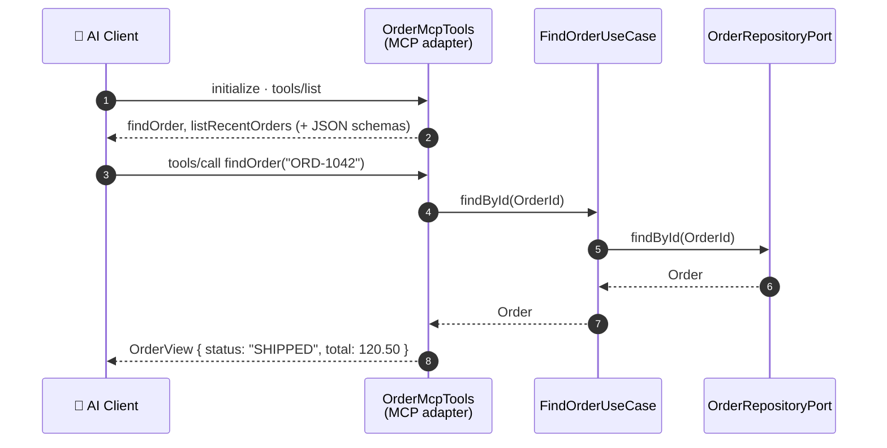

# orders-mcp ⬡🤖

> **An MCP server is just another driving adapter.** A hexagonal Spring Boot service that exposes the same use cases to humans (REST) and to AI agents (Model Context Protocol).


| What | Choice |
|---|---|
| Language | Java 25 (LTS) |
| Framework | Spring Boot 4.1 · Spring Framework 7 · Spring AI 2.0 |
| MCP | `@McpTool` annotations · Streamable HTTP on `/mcp` |
| Build | Gradle 9.9 · Kotlin DSL · version catalog |
| Architecture | Hexagonal (Ports & Adapters), enforced with ArchUnit |
| Observability | Micrometer → Prometheus → Grafana |
| Load testing | k6 |

---

## 🧩 Architecture



## 🔄 A tool call, end to end



## 📁 Structure

```text
src/main/java/dev/cbuelvasc/orders/
├── domain/                     ← pure Java, no frameworks
│   ├── model/                  Order, OrderId, CustomerId, OrderStatus
│   ├── exception/              OrderNotFoundException
│   └── port/
│       ├── in/                 FindOrderUseCase, ListRecentOrdersUseCase
│       └── out/                OrderRepositoryPort
├── application/                OrderQueryService (no Spring annotations)
└── infrastructure/
    ├── adapter/
    │   ├── in/mcp/             OrderMcpTools, OrderView   ← AI entry door
    │   ├── in/rest/            OrderController            ← human entry door
    │   └── out/memory/         InMemoryOrderRepository
    └── config/                 UseCaseConfig
```

## 🚀 Run it

Requirements: **JDK 25**.

```bash
./gradlew bootRun
```

| Endpoint | What |
|---|---|
| `POST /mcp` | MCP server (Streamable HTTP) |
| `GET /api/orders/ORD-1042` | REST: one order |
| `GET /api/orders?customerId=CUS-1&limit=5` | REST: recent orders |
| `GET /actuator/prometheus` | Metrics: `mcp_tool_duration_seconds`, `mcp_tool_errors_total` |

Demo data: orders `ORD-1000` … `ORD-1059`, customers `CUS-1` … `CUS-6`.

### Connect an MCP client

Use the [MCP Inspector](https://github.com/modelcontextprotocol/inspector) with transport **Streamable HTTP** and URL `http://localhost:8080/mcp`, or add it to any MCP-compatible client.

## 🧪 Tests

```bash
./gradlew test
```

- **Unit tests** for the core and the MCP adapter (no Spring context).
- **ArchUnit rules** that keep the hexagon honest:
  - the domain is pure Java,
  - the core never depends on infrastructure,
  - only the MCP adapter knows about MCP,
  - inbound adapters talk to ports, not to the service.

## ⚡ Load test

```bash
k6 run k6/mcp-load-test.js
```

Ramps to 200 tool calls/second to simulate bursty agent traffic, with thresholds on error rate and p95 latency.

## 🛣️ Roadmap

- [ ] JPA/PostgreSQL driven adapter (the core does not change)
- [ ] OAuth 2.1 resource server + scopes per tool
- [ ] Grafana dashboard JSON
- [ ] Same server in **Go** with the official MCP Go SDK, with benchmarks

---

📝 Blog post: [cbuelvasc.hashnode.dev](https://cbuelvasc.hashnode.dev)
