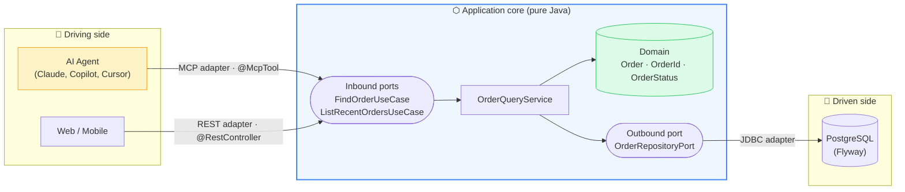
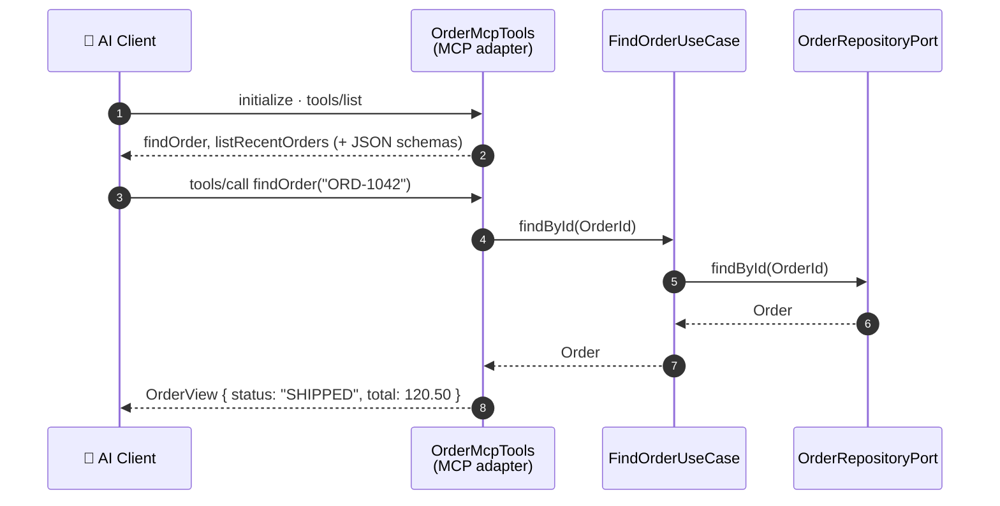
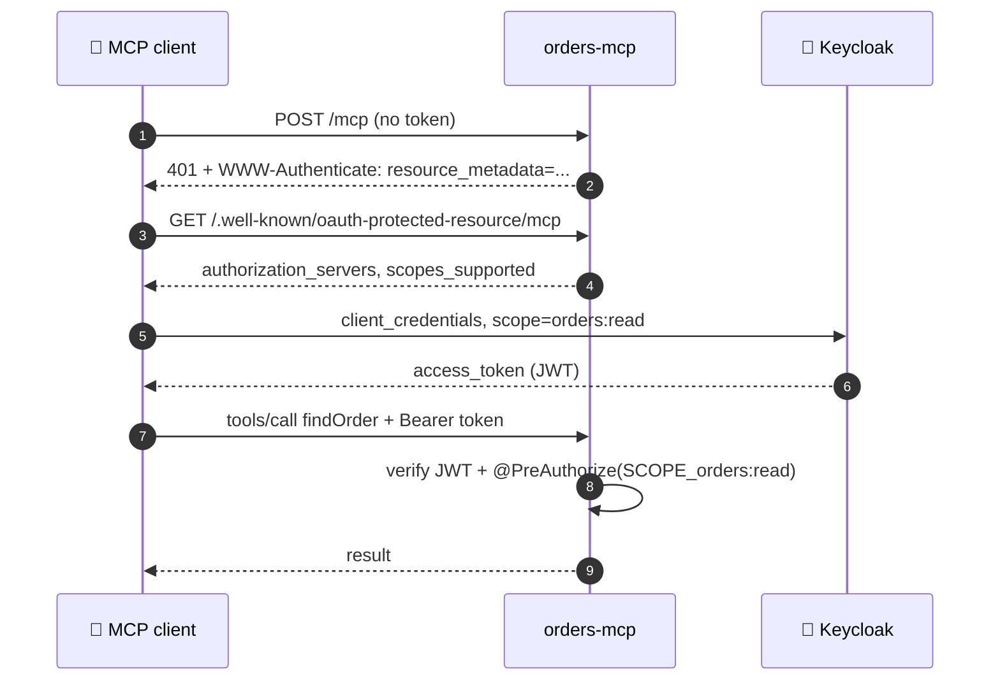

# orders-mcp ⬡🤖

> **An MCP server is just another driving adapter.** A hexagonal Spring Boot service that exposes the same use cases to humans (REST) and to AI agents (Model Context Protocol).


| What | Choice |
|---|---|
| Language | Java 25 (LTS) |
| Framework | Spring Boot 4.1 · Spring Framework 7 · Spring AI 2.0 |
| MCP | `@McpTool` annotations · Streamable HTTP on `/mcp` |
| Build | Gradle 9.9 · Kotlin DSL · version catalog |
| Architecture | Hexagonal (Ports & Adapters), enforced with ArchUnit |
| Security | OAuth 2.1 resource server · scopes per tool · RFC 9728 |
| Persistence | PostgreSQL · JdbcClient · Flyway · Testcontainers |
| Observability | Micrometer → Prometheus → Grafana |
| Load testing | k6 |

---

## 🧩 Architecture



## 🔄 A tool call, end to end



## 📁 Structure

```text
src/main/java/dev/cbuelvasc/orders/
├── domain/                     ← pure Java, no frameworks
│   ├── model/                  Order, OrderId, CustomerId, OrderStatus
│   ├── exception/              OrderNotFoundException, OrderCannotBeCancelledException
│   └── port/
│       ├── in/                 FindOrderUseCase, ListRecentOrdersUseCase, CancelOrderUseCase
│       └── out/                OrderRepositoryPort
├── application/                OrderQueryService, CancelOrderService
└── infrastructure/
    ├── adapter/
    │   ├── in/mcp/             OrderMcpTools, OrderView   ← AI entry door
    │   ├── in/rest/            OrderController            ← human entry door
    │   └── out/jdbc/           JdbcOrderRepository        ← PostgreSQL
    ├── security/               SecurityConfig, RFC 9728 metadata
    └── config/                 UseCaseConfig
```

## 🚀 Run it

Requirements: **JDK 25** and **Docker**.

```bash
./gradlew bootRun
```

`bootRun` starts the whole local stack from `compose.yaml` (thanks to `spring-boot-docker-compose`):

| Service | URL | What |
|---|---|---|
| orders-mcp | http://localhost:8080/mcp | MCP server (Streamable HTTP, OAuth 2.1 protected) |
| PostgreSQL | localhost:5432 | Orders, migrated and seeded by Flyway |
| Keycloak | http://localhost:8180 | Authorization server, realm `orders` (admin/admin) |
| Prometheus | http://localhost:9090 | Scrapes `/actuator/prometheus` |
| Grafana | http://localhost:3000 | Dashboard **MCP › Orders MCP · Tools** |

Demo data: orders `ORD-1000` … `ORD-1059`, customers `CUS-1` … `CUS-6`.

### Call it with a token

```bash
TOKEN=$(./scripts/get-token.sh orders-readonly orders:read)
curl -i http://localhost:8080/api/orders/ORD-1042 -H "Authorization: Bearer $TOKEN"

# Without a token the MCP endpoint answers 401 and tells the client where to look:
curl -i -X POST http://localhost:8080/mcp
# WWW-Authenticate: Bearer resource_metadata="http://localhost:8080/.well-known/oauth-protected-resource/mcp"
```

| Demo client | Secret | Scopes | Can call |
|---|---|---|---|
| `orders-readonly` | `orders-readonly-secret` | `orders:read` | `findOrder`, `listRecentOrders` |
| `orders-agent` | `orders-agent-secret` | `orders:read` + optional `orders:write` | all tools, including `cancelOrder` |

> Secrets and passwords in `compose.yaml` and the realm file are **local demo values**.

### Connect an MCP client

Use the [MCP Inspector](https://github.com/modelcontextprotocol/inspector) with transport **Streamable HTTP**, URL `http://localhost:8080/mcp` and a bearer token from the script above.

## 🔐 Security (part 2)



| Tool | Required scope |
|---|---|
| `findOrder` | `orders:read` |
| `listRecentOrders` | `orders:read` |
| `cancelOrder` | `orders:write` |

## 🐘 Persistence (part 3)

The driven adapter is now `JdbcOrderRepository` (plain SQL with `JdbcClient` + Flyway). The core did not change. Both adapters, the in-memory fake and PostgreSQL, pass the **same contract test** (`OrderRepositoryContract`), the PostgreSQL one with **Testcontainers**.

## 📊 Observability (part 4)

Every tool call records `mcp.tool.duration` (histogram, p95/p99, SLO buckets) and `mcp.tool.errors`. Grafana is provisioned with a dashboard: calls/s, p95 by tool, error ratio, SLO under 100 ms, 401/403 on `/mcp` and JVM.

## 🧪 Tests

```bash
./gradlew test     # needs Docker for the Testcontainers tests
```

- **Unit tests** for the core and the MCP adapter (no Spring context).
- **Contract tests** for the outbound port: in-memory and PostgreSQL.
- **Integration tests** with Testcontainers: scopes per tool, 401 + resource metadata, Flyway seed.
- **ArchUnit rules** that keep the hexagon honest:
  - the domain is pure Java,
  - the core never depends on infrastructure,
  - only the MCP adapter knows about MCP,
  - only the JDBC adapter knows about SQL,
  - inbound adapters talk to ports, not to the service.

## ⚡ Load test

```bash
k6 run k6/mcp-load-test.js
```

Gets a real token with `client_credentials`, then ramps to 200 tool calls/second with thresholds on error rate and p95 latency per tool. Watch it live in Grafana.

## 🛣️ Roadmap

- [x] Part 1: hexagonal MCP server with Spring AI
- [x] Part 2: OAuth 2.1 resource server + scopes per tool
- [x] Part 3: PostgreSQL adapter, the core does not change
- [x] Part 4: Grafana dashboard + k6 with real tokens
- [ ] Part 5: the same server in **Go** with the official MCP Go SDK
- [ ] Part 6: Java vs Go benchmarks

## 👤 Author

**Carmelo Buelvas** · Senior Backend Engineer · Java, Go & AI (MCP)

[](https://www.linkedin.com/in/cbuelvasc/)
[](https://cbuelvasc.hashnode.dev)
[](https://github.com/cbuelvasc)
